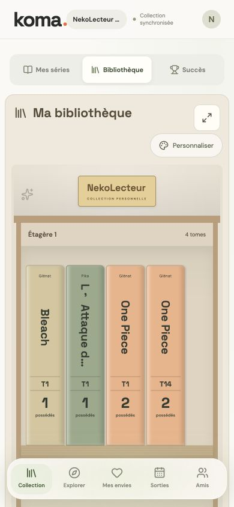

# Koma · Ma mangathèque

### Retrouver ses mangas, suivre ses lectures et préparer les prochains tomes.

**React · TypeScript · Vinext / Vite · Cloudflare D1 · Drizzle · R2**

Koma est une application de gestion de collection de mangas. Elle réunit la collection possédée, les envies, le suivi des séries et les sorties dans une interface pensée pour être utilisée sur téléphone, notamment en librairie.

Ce dépôt publie la **version web**, installable comme application web. Le client Expo associé est un projet distinct et n’est pas inclus ici.



*Aperçu de la bibliothèque, état du 18 octobre 2026.*

## Les usages principaux

| Besoin | Réponse dans Koma |
| --- | --- |
| Savoir si je possède déjà un tome | Recherche ISBN, scan et mode librairie à partir de la copie locale. |
| Organiser ma collection | Séries, éditions, bibliothèque personnalisable, statut de lecture et rangement. |
| Préparer mes prochains achats | Envies, calendrier des sorties, suivi des séries et budget saisi manuellement. |
| Partager avec mes proches | Invitations entre amis, collection partagée sur choix explicite, prêts et liste cadeau révocable. |
| Garder la main sur mes données | Import/export, copie locale, file de synchronisation et sauvegardes dans la base. |

## Un produit autour de la collection

- Recherche de mangas et ajout par ISBN ou par lots ; distinction des éditions et fiches personnelles pour les références absentes.
- Scanner avec lecture de code-barres et gestion de la caméra ; son comportement matériel reste à vérifier sur les appareils utilisés.
- Calendrier des sorties et abonnement ICS privé pour les séries suivies.
- Suivi des lectures, pile à lire, bilan mensuel et progression de la bibliothèque.
- Photos personnelles de tranches, emplacements, prêts et partage cadeau avec réservation.
- Consultation de la dernière copie hors connexion et synchronisation des changements en attente.

Le détail des fonctionnalités et de leurs limites figure dans [FEATURES.md](FEATURES.md).

## Architecture

```text
Interface React responsive / application web installable
                         │
                         ▼
             Routes API · Vinext / Worker
                    │             │
                    ▼             ▼
              D1 + Drizzle    R2 · photos
```

Les données personnelles sont rattachées au compte. Les collections sont privées par défaut et leur partage repose sur une action explicite. Le budget et les emplacements précis restent privés.

La version hébergée utilise l’identité fournie par Sites. Le développement local propose une identité fictive sur loopback ; il ne faut pas traiter ce mode de développement comme un système d’authentification de production autonome.

## Démarrer en local

Prérequis : **Node.js 22.13+**, npm et Git. Le développement utilise des services Cloudflare simulés localement, sans accès à la base hébergée.

```sh
git clone https://github.com/WeeckNess/Koma.git
cd Koma
npm run install:ci
npm run dev
```

Ouvrir l’adresse affichée, généralement **http://localhost:5173**. Pour explorer les fonctions personnelles en développement local :

```text
http://localhost:5173/signin-with-chatgpt?return_to=/
```

L’identité locale et les données de test sont fictives. Les fichiers d’état `.wrangler/`, les variables d’environnement et les dépendances ne sont pas publiés.

## Vérifications

```sh
npm run lint
npx tsc --noEmit
npm run build
node scripts/test-reader.mjs
node scripts/test-series.mjs
node scripts/test-camera-focus.mjs
```

Les tests API de `scripts/test-api.mjs` et `scripts/test-reader-api.mjs` nécessitent un serveur local et une base de test. Ils effectuent des mutations : voir [KOMA.md](KOMA.md) et [FEATURES.md](FEATURES.md), et ne pas les diriger vers une instance hébergée.

La vérification de style (`npm run lint`) relève actuellement des erreurs dans les sources existantes ; son nettoyage reste à faire. Le dépôt est présenté comme un projet en développement, sans badge affirmant que tous les contrôles passent.

## Repères dans le dépôt

```text
app/          Interface et routes API
lib/          Catalogue, collection, lecture et synchronisation
db/           Schéma et accès à la base
drizzle/      Migrations SQL
scripts/      Installation et vérifications
docs/         Catalogue, scanner et aperçu visuel
build/        Adaptation du runtime Sites
```

## Périmètre et limites

Les catalogues et dates de sorties proviennent de sources externes partielles : une absence ou une fiche périmée reste possible. Les métadonnées, couvertures et marques tierces conservent leurs droits respectifs. Leur présence ne constitue pas une licence de redistribution générale.

Les sauvegardes intégrées sont des copies dans la même base ; l’export permet de conserver une copie externe. Le fonctionnement hors connexion, les conflits de synchronisation et les limites du scan sont détaillés dans la documentation.

Un déploiement hors Sites nécessite d’adapter l’authentification et les liaisons Cloudflare. Ce dépôt ne contient ni accès au site hébergé ni copie de ses collections privées.

## Documentation

- [Fonctionnement, comptes, synchronisation et hébergement](KOMA.md)
- [Fonctionnalités détaillées](FEATURES.md)
- [Runtime et développement](DEVELOPMENT.md)
- [Scanner et autofocus](docs/scanner-autofocus.md)

Projet présenté dans le portfolio de **Thom Legros — [WeeckNess](https://github.com/WeeckNess)**.
